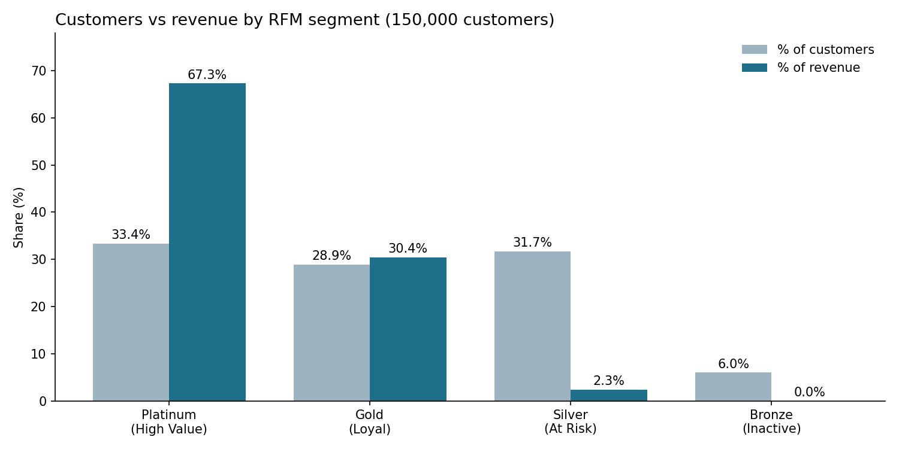
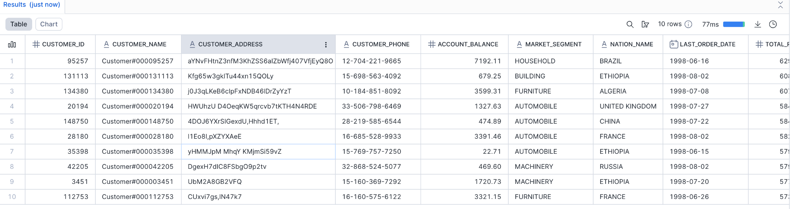
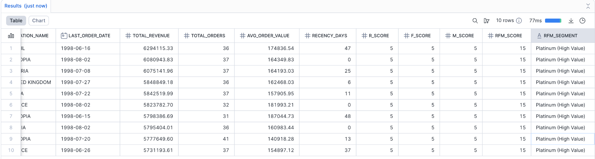
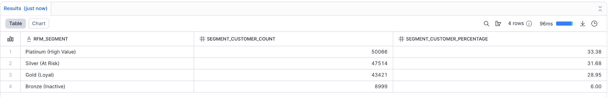
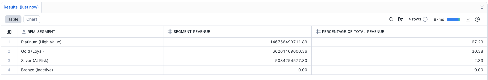
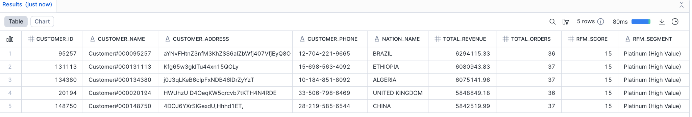
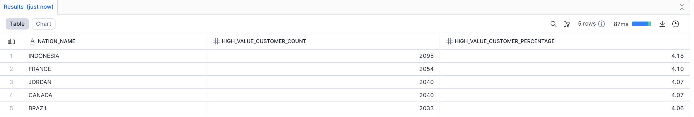

# Customer Segmentation with RFM Analysis (SQL)

Segmenting 150,000 retail customers by **Recency, Frequency and Monetary value** in Snowflake SQL, then turning the segments into marketing recommendations.

**Hyper Island · Databases & SQL Fundamentals · November 2025**

## Key findings

| | |
|---|---|
| **Revenue is concentrated** | Platinum customers are 33% of the customer base but generate 67% of revenue |
| **Top customers** | The top 5 customers each generated over $5.8M from 36–37 orders, all with the maximum RFM score of 15 |
| **Low-value tail** | Silver and Bronze together are 38% of customers but only 2.3% of revenue |
| **No single key market** | High Value customers are spread evenly: the top 5 nations (Indonesia, France, Jordan, Canada, Brazil) each hold about 4% |

## Recommendations

- **Platinum:** protect revenue with VIP programmes, personalised rewards and exclusive offers
- **Gold:** grow order frequency through upselling and cross-selling
- **Silver and Bronze:** test low-cost reactivation campaigns before investing further
- **Geography:** because High Value customers are spread evenly across nations, segment-based campaigns will matter more than country-based ones

## Approach

| Step | What it does | SQL technique |
|---|---|---|
| **1. Build the base** | Customers joined to nations, orders and line items | `INNER JOIN` for nations, `LEFT JOIN` so customers without orders are kept |
| **2. Calculate metrics** | Orders, revenue (price × (1 − discount)), average order value, last order date | `COUNT(DISTINCT)`, `SUM`, `NULLIF` to avoid division by zero |
| **3. Recency** | Days since each customer's last order, measured from the latest order in the dataset | `DATEDIFF` with a snapshot CTE |
| **4. Score** | Each customer scored 1–5 on Recency, Frequency and Monetary (quintiles) | `NTILE(5)` window functions |
| **5. Segment** | Scores summed (3–15) and grouped into four segments | `CASE` logic |

| Segment | RFM score |
|---|---|
| Platinum (High Value) | 12–15 |
| Gold (Loyal) | 8–11 |
| Silver (At Risk) | 4–7 |
| Bronze (Inactive) | 3 |

The whole pipeline is one query built from 7 CTEs, so each step can be read and checked on its own.

## Queries

| File | Question answered |
|---|---|
| [`01_rfm_segmentation.sql`](sql/01_rfm_segmentation.sql) | Full RFM table, one row per customer (top 10 shown) |
| [`02_customers_per_segment.sql`](sql/02_customers_per_segment.sql) | How many customers are in each segment? |
| [`03_revenue_per_segment.sql`](sql/03_revenue_per_segment.sql) | How much revenue does each segment generate? |
| [`04_top5_high_value_customers.sql`](sql/04_top5_high_value_customers.sql) | Who are the top 5 High Value customers? |
| [`05_top_nations_high_value.sql`](sql/05_top_nations_high_value.sql) | Which nations have the most High Value customers? |

Every file is self-contained and runs as-is.

## Results

**Top 10 customers by RFM score**

**Customers and revenue per segment**

**Top 5 High Value customers and top nations**

The full written report, including the written insights, is in [`docs/rfm_analysis_report.pdf`](docs/rfm_analysis_report.pdf).

## Limitations and what I'd change

- **Customers who never ordered.** In this dataset about a third of the 150,000 customers have no orders. They all tie at 0 orders and 0 revenue, and `NTILE` splits tied values across different buckets, so identical customers received different scores and landed in either Silver or Bronze. That is why Silver ("At Risk") has very little revenue. A better design would put non-buyers in a separate "No orders" segment and score only active customers.
- **Tie-breaking.** Adding a unique column (such as `customer_id`) to each `NTILE` ordering would make the scores fully repeatable between runs.
- **Equal weights.** R, F and M are weighted equally. Testing different weights, or segmenting on score combinations instead of the total, could separate loyal customers from big one-off spenders.

## Run it yourself

The data is the free `SNOWFLAKE_SAMPLE_DATA.TPCH_SF1` share, available in every Snowflake account, including free trials. Open any file from `sql/` in a Snowflake worksheet and run it.

## Built with

SQL · Snowflake · CTEs · window functions (`NTILE`, `SUM() OVER`) · `CASE` logic
